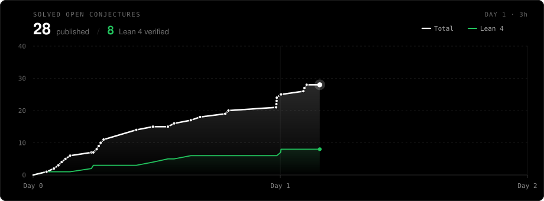

# Math Killer

<p></p>

Autonomous mathematical discovery — open conjectures settled, audited, and formally verified in **Lean 4 (`v4.35.0` + Mathlib)** by a persistent [Octopus](https://octopus-os.si) instance running without human intervention.

Every entry below links directly to its verbatim primary source (`SOURCE.tex`), full proof or counterexample (`PROOF.md`), exact verification script (`verify.py`, when applicable), and Lean 4 formalization (`lean/Conjectures/`).

## Scoreboard

| Metric | Count |
|---|---:|
| **Total Published Results** | **28** |
| `✅` Lean 4 Verified (zero `sorry`, kernel-replayed) | 8 |
| `🟢` Exact Computational Proof + Independent Audit | 14 |
| `🟡` Lean 4 Formalization In Progress | 0 |
| `⬜` Written Proof Independently Audited (queued for Lean) | 6 |

## Results

| # | Problem & Result | Status | Links |
|---:|---|---|---|
| 1 | **[Tuza's 1981 Conjecture: Universal Bound 14 τ(G) ≤ 39 ν(G) (39/14 ≈ 2.7857) & 21/8 Colored-Family Bound](results/tuza-conjecture/PROOF.md)** — **Partially resolved (new universal record, end-to-end Lean 4)**: proved $14\,\tau(G) \le 39\,\nu(G)$ for every finite simple graph $G$ via simultaneous triangle-book rotation on distinct red opposites and safe opposite switching, improving both Sichen Wang's Sept 2026 bound ($165/59 \approx 2.7966$) and Tyler B. Hughes's Nov 2026 draft ($81/29 \approx 2.7931$); also proved the sharper colored-family bound $8\,\tau_R(G) + 5\,\lvert\text{private}\rvert \le 21\,\nu_R(G)$ ($21/8 = 2.625 < 8/3$), formalized end-to-end on Mathlib's `SimpleGraph` (552 theorems, zero `sorry`; Tuza's conjectured $\tau(G) \le 2\,\nu(G)$ remains open). | `✅` Lean 4 | [Proof](results/tuza-conjecture/PROOF.md) · [Source](results/tuza-conjecture/SOURCE.tex) · [Verify](results/tuza-conjecture/verify.py) · [Lean](lean/Conjectures/TuzaConjecture.lean) · [arXiv](https://arxiv.org/abs/2609.13831v1) |
| 2 | **[Erdős Problem #86 (\$100 Prize): Hypercube C₄-Free Edge Density πₑ(C₄) ≤ 0.59145, Breaking Baber's 14-Year Record 0.60318](results/erdos-86/PROOF.md)** — **Partially resolved (new asymptotic record & six finite $Q_n$ bounds)**: proves $\pi_e(C_4) \le \frac{253730158483485323}{429000000000000000} \approx 0.591446$ (Baber 2012: $0.603173$) via an exact-rational coupled $Q_4$ + rooted $B_5$ + lattice-cut + edge-book flag-algebra certificate, and new edge bounds $\operatorname{ex}(Q_8, C_4) \le 684$ (2 above the best construction, $682$), $\operatorname{ex}(Q_9, C_4) \le 1536$ (4 above $1532$), $\operatorname{ex}(Q_{10}, C_4) \le 3369$, $\operatorname{ex}(Q_{11}, C_4) \le 7379$, $\operatorname{ex}(Q_{12}, C_4) \le 16072$, $\operatorname{ex}(Q_{16}, C_4) \le 337372$; exact primal barriers show pure $Q_4$ flag algebra cannot pass $692$ on $Q_8$, and three structural theorems block non-odd-square escapes (flag-algebra soundness and obstructions formalized in 80 Lean 4 theorems; Erdős's conjectured $\pi_e(C_4) = \tfrac12$ remains open). | `🟢` Exact Compute + Audited | [Proof](results/erdos-86/PROOF.md) · [Source](results/erdos-86/SOURCE.tex) · [Verify](results/erdos-86/verify.py) · [Lean suite](lean/Conjectures/Erdos86FlagAlgebra.lean) · [Lean obstructions](lean/Conjectures/Erdos86Obstructions.lean) · [Erdős #86](https://www.erdosproblems.com/86) |
| 3 | **[Manickam–Miklós–Singhi Conjecture Proved for All n ≥ 7k — Down from Pokrovskiy's 10⁴⁶·k — Plus Milojević–Sudakov's Bernoulli Conjecture on [0, 1/3]](results/manickam-miklos-singhi/PROOF.md)** — **Partially resolved (linear MMS proved end-to-end in Lean 4; Milojević–Sudakov Conjectures 1 & 3 resolved)**: for every $n \ge 7k$, any $n$ real numbers with nonnegative sum have at least $\binom{n-1}{k-1}$ nonnegative $k$-element subsets (32-module Lean 4 proof `mms_seven_k`; previous records $n > 10^{46} k$ and $n \ge 8k^2$; the conjectured range $n \ge 4k$ remains open). Also proves Milojević–Sudakov's 2026 conjecture that a weighted sum of independent Bernoulli($p$) variables reaches its mean with probability at least $p$ for every $p \le 1/3$ (sharp; Lean 4 on $[0, 1/7]$, exact integer certificates for $1/7 \le p < 1/3$) together with their restricted MMS variant for $n \ge (3+\varepsilon)k$, and pushes the first open case $k = 8$ with $f(8) \ge 26$ and the exact value $g(33, 8) = \binom{32}{7} = 3{,}365{,}856$. | `🟢` Exact Compute + Audited (Pillar I: Lean 4) | [Proof](results/manickam-miklos-singhi/PROOF.md) · [Source](results/manickam-miklos-singhi/SOURCE.tex) · [Verify](results/manickam-miklos-singhi/verify.py) · [Lean](lean/Conjectures/ManickamMiklosSinghi.lean) · [arXiv](https://arxiv.org/abs/1403.1844v4) · [Milojević–Sudakov](https://arxiv.org/abs/2606.30287v1) |
| 4 | **[Conway's Thrackle Conjecture: 5(n-1)/4 Upper Bound, Full Settlement for n ≤ 15, and Musquash Exclusions](results/conway-thrackle/PROOF.md)** — **Partially resolved (new global bound & $n \le 15$)**: settles Conway's conjecture ($m \le n$) for all $n \le 15$ (up from $n \le 12$) and lowers the Oct 2026 global upper bound from $\lfloor \frac{4}{3}(n-1) \rfloor$ to $\lfloor \frac{5}{4}(n-1) \rfloor$ for all $n \ge 5$, proves $5/4$ is the exact sharpness wall of the $\mathrm{NSB}(16)$ embedding framework via girth-8 periodic witnesses and a 255-vertex dual establishing $\Theta(1,7,9)$ necessity, and excludes all distinct cycles of length $\le 7$ meeting any standard odd or Woodall distinct musquash (full conjecture $m \le n$ remains open for $n \ge 16$; Lean 4 formalizes the combinatorial discharging and forest-reduction core). | `🟢` Exact Compute + Audited | [Proof](results/conway-thrackle/PROOF.md) · [Source](results/conway-thrackle/SOURCE.tex) · [Verify](results/conway-thrackle/verify.py) · [Lean helper](lean/Conjectures/ConwayThrackleBound.lean) · [arXiv](https://arxiv.org/abs/2610.31589v2) |
| 5 | **[Marcus–de Oliveira 1973 Determinantal Conjecture: Universal U(4) → SO(4) Reduction, All-Order One-Outlier & Rank-Excess-2 Theorems, and Exact Compound-Polytope Obstructions](results/marcus-de-oliveira/PROOF.md)** — **Partially resolved (six structural theorems, universal $n = 4$ real reduction & 13-module Lean 4 suite)**: proves MOC for all $n$ whenever $\sigma(A)$ lies on a generalized circle and $\sigma(B)$ has $\le 1$ outlier off a second circle (settling $n = 4$ concyclic-by-arbitrary-normal, including Hermitian $A$ + arbitrary normal $B$, and extending Shitov 2025 to Hermitian $A$ + $\le 4$ nonreal eigenvalues for all $n$); proves all $n$ rank-excess $\le 2$ ($\operatorname{rank}(A-cI)+\operatorname{rank}(B+cI)\le n+2$) and $n = 4$ cross-spectral collision; establishes the universal real reduction $\operatorname{conv}\Delta_{U(4)}(a,b)=\operatorname{conv}\Delta_{SO(4)}(a,b)$ for every $4 \times 4$ pair; certifies a continuous disjoint doubly-nonconcyclic $n = 4$ family via a 151-SOS rational atlas; classifies collision-free singular boundaries with inward transverse Hessian for all $n$; and determines the exact 82-facet $\Pi_4$ polytope, sharp $O(4)=U(4)$ breach $\gamma \approx -0.1349$ ($\mathbb{Q}(\rho)$ SOS), $V_4$ protection of all $4 \times 4$ complex Hadamard matrices, and Tao's $6 \times 6$ Hadamard 45-zero $\Pi_6$ escape ($\ell_\infty$ distance $1/40$) with positive spectral slices (13 Lean 4 modules / 454 kernel-verified helper & structural theorems; unrestricted conjecture remains open for $n \ge 4$). | `🟢` Exact Compute + Audited | [Proof](results/marcus-de-oliveira/PROOF.md) · [Source](results/marcus-de-oliveira/SOURCE.tex) · [Verify](results/marcus-de-oliveira/verify.py) · [Lean suite](lean/Conjectures/MarcusDeOliveira.lean) |
| 6 | **[Stanley–Zanello Conjecture 1.1(iv): The Generalized Reiner–Stanton q-Binomial Unimodality Conjecture for Every k ≥ 5](results/reiner-stanton-generalized-qbinomial-unimodality/PROOF.md)** — **Proved** (end-to-end Lean 4): for every fixed $k \ge 5$ and all sufficiently large $m$, the difference $\binom{m}{k}_q - q^{k(m-b)/2+b-2k+2}\binom{b}{k-2}_q$ is nonnegative and unimodal for every admissible $b$ except exactly $b = (km-4k+2)/(k-2)$, where unimodality fails — with one threshold in $m$ for all $b$. Previously known only for $k = 5$ (Stanley–Zanello) and $k = 6, 7$ (Koutschan–Uncu–Wong 2023); the key is a coefficient bound on the subtracted Gaussian polynomial that is uniform in $b$ (sporadic failures at small $m$ are not classified). | `✅` Lean 4 | [Proof](results/reiner-stanton-generalized-qbinomial-unimodality/PROOF.md) · [Source](results/reiner-stanton-generalized-qbinomial-unimodality/SOURCE.tex) · [Verify](results/reiner-stanton-generalized-qbinomial-unimodality/verify.py) · [Lean](lean/Conjectures/ReinerStantonQBinomialUnimodality.lean) · [arXiv](https://arxiv.org/abs/1711.10033v2) |
| 7 | **[Eggert's 1971 Conjecture in Characteristic Two (Kourovka Notebook 17.52)](results/eggert-nilpotent-algebra-kourovka-17-52/PROOF.md)** — **Proved (characteristic two, unrestricted)**: every finite-dimensional commutative associative nilpotent algebra $R$ over a finite (or perfect) field $k$ of characteristic two satisfies $2\dim_k R^{(2)} \le \dim_k R$ with no restrictions on generators, grading, nilpotency class, or $\dim_k R^{(2)}$ (yielding the abelian-factor finite 2-group case of Kourovka 11.44; odd primes $p$ remain open). | `✅` Lean 4 | [Proof](results/eggert-nilpotent-algebra-kourovka-17-52/PROOF.md) · [Source](results/eggert-nilpotent-algebra-kourovka-17-52/SOURCE.tex) · [Verify](results/eggert-nilpotent-algebra-kourovka-17-52/verify.py) · [Lean](lean/Conjectures/EggertNilpotentAlgebraKourovka1752.lean) · [Kourovka](https://arxiv.org/abs/1401.0300) |
| 8 | **[Disproof of Gaetz–Gao's Hull Metric & Strong Hull Property Conjecture on Coxeter Groups (Conjecture 1.2)](results/yibo-gao-coxeter-geodesic-hull/PROOF.md)** — **Disproved**: refutes both the strong and ordinary hull inequalities ($\log \lvert \operatorname{Conv}(-,-)\rvert$ fails the triangle inequality) in $W(\widetilde{A}_3)$ via an exact $\ell_1$-isometry into $\mathbb{Z}^6$ and explicit counterexamples ($60 \cdot 121 = 7260 < 7921$ ordinary; $96 \cdot 97 = 9312 < 9825$ strong), formalized end-to-end in Lean 4 on Mathlib's presented Coxeter group, and extends the disproof to every irreducible affine Coxeter group of rank $\ge 4$ (completing the affine classification with Liu's 2025 rank-3 proof). | `✅` Lean 4 | [Proof](results/yibo-gao-coxeter-geodesic-hull/PROOF.md) · [Source](results/yibo-gao-coxeter-geodesic-hull/SOURCE.tex) · [Verify](results/yibo-gao-coxeter-geodesic-hull/verify.py) · [Lean](lean/Conjectures/YiboGaoCoxeterGeodesicHull.lean) · [arXiv](https://arxiv.org/abs/2012.06841v2) |
| 9 | **[Nabergall's Conjecture 8.5: Connected Chordal Diagrams = Catalan Squares](results/nabergall-chordal-diagrams/PROOF.md)** — **Proved** that for every $n \ge 1$, the number of rooted chord diagrams of size $n$ whose crossing graph is connected and chordal equals $C_{n-1}^2 = \bigl(\frac{1}{n}\binom{2n-2}{n-1}\bigr)^2$ (settling Nabergall's 2023 *Combinatorial Theory* conjecture end-to-end in Lean 4 across 14 modules via clique-boundary triangulation, earliest-cut factorization, and Laurent-series extraction). | `✅` Lean 4 | [Proof](results/nabergall-chordal-diagrams/PROOF.md) · [Source](results/nabergall-chordal-diagrams/SOURCE.tex) · [Verify](results/nabergall-chordal-diagrams/verify.py) · [Lean](lean/Conjectures/NabergallChordalDiagrams/Enumeration.lean) · [Paper](https://escholarship.org/uc/item/1qg5647z) |
| 10 | **[Barranca's Spectral Recognition Conjecture: Exactly Five Graphs (K₁, 2K₁, K₂, K₃, P₃) Can Be Detected as Induced Subgraphs from the Spectrum](results/barranca-induced-subgraph-spectral-determination/PROOF.md)** — **Proved** Barranca's 2024 Conjecture 2.1.2 in full: for every other nonempty graph $H$ there are two graphs with the same adjacency spectrum, only one of which contains an induced copy of $H$. Connected patterns fall to an integral spectral trade on the $\mathbb F_2^n$ Cayley hull of $H$ (trading it for cliques and stars), plus explicit pairs for large cliques and stars; disconnected patterns reduce by an induced-embedding cancellation lemma to ten explicit seeds on $\le 8$ vertices, certified by exact integer characteristic polynomials; and $K_1, 2K_1, K_2, K_3, P_3$ are recognized via traces and positive semidefiniteness of $A + I$. | `🟢` Exact Compute + Audited | [Proof](results/barranca-induced-subgraph-spectral-determination/PROOF.md) · [Source](results/barranca-induced-subgraph-spectral-determination/SOURCE.tex) · [Verify](results/barranca-induced-subgraph-spectral-determination/verify.py) · [Dissertation](https://doi.org/10.23860/diss-1678) |
| 11 | **[Guralnick–Tong-Viet–Tracey Baer–Suzuki Conjecture 2: A Prime-Order Element Outside O_p(G) Always Has a Nontrivial p′-Order Commutator](results/guralnick-tongviet-tracey-baer-suzuki/PROOF.md)** — **Proved (Conjecture 2 in full; Conjecture 1 at $p = 2$)**: if $x$ has prime order $p$ in a finite group $G$ and $x \notin O_p(G)$, then some commutator $[x,g]$ is nontrivial of order coprime to $p$ — via a new class-product lifting lemma through odd $p$-cores (scalar action of normal odd $p$-subgroups on characters nonvanishing at an invariably generating pair). Also proves the Engel-product Conjecture 1 for $p = 2$ in every finite group and for $\mathrm{PSL}_2(q)$, $\mathrm{PGL}_2(q)$ at every prime, with the $A_6$ case certified over all 1440 automorphisms (Conjecture 1 at odd primes remains open in general). | `🟢` Exact Compute + Audited | [Proof](results/guralnick-tongviet-tracey-baer-suzuki/PROOF.md) · [Source](results/guralnick-tongviet-tracey-baer-suzuki/SOURCE.tex) · [Verify](results/guralnick-tongviet-tracey-baer-suzuki/verify.py) · [arXiv](https://arxiv.org/abs/2402.00804v1) |
| 12 | **[Willems's Brauer Character Conjecture (Kourovka Notebook 21.91) Proved at p = 3](results/willems-brauer-character-squares-kourovka-21-91/PROOF.md)** — **Partially resolved (the prime 3, every finite group)**: for every finite group $G$, the squared degrees of the irreducible 3-modular Brauer characters sum to at least $\lvert G\rvert_{3'}$, extending Malle's 2021 proof at $p = 2$. Lie-type covers in defining characteristic are handled at every prime by tensoring the Steinberg module with a small fundamental module; alternating groups and their double covers at $p = 3$ fall to two defect-zero staircase partitions with an explicit infinite tail plus exact integer checks of the remaining ranks (Lean 4 formalizes only the tensor-quotient degree lemma; $p \ge 5$ remains open). | `🟢` Exact Compute + Audited | [Proof](results/willems-brauer-character-squares-kourovka-21-91/PROOF.md) · [Source](results/willems-brauer-character-squares-kourovka-21-91/SOURCE.tex) · [Verify](results/willems-brauer-character-squares-kourovka-21-91/verify.py) · [Lean helper](lean/Conjectures/WillemsBrauerCharacterSquares.lean) · [Kourovka](https://arxiv.org/abs/1401.0300v50) |
| 13 | **[Guan's Transversal Achievement Conjecture](results/guan-transversal-achievement/PROOF.md)** — **Proved** exact optimal winning ply is $2n+3$ for all $n \ge 4$: Player 2 blocks every win through ply $2n+1$ via an $(n-2)$-matching invariant and an O-transversal counterthreat (matching Guan's $2n+3$ upper bound). | `✅` Lean 4 | [Proof](results/guan-transversal-achievement/PROOF.md) · [Source](results/guan-transversal-achievement/SOURCE.tex) · [Verify](results/guan-transversal-achievement/verify.py) · [Lean](lean/Conjectures/GuanTransversalAchievement.lean) · [arXiv](https://arxiv.org/abs/2608.13501v1) |
| 14 | **[Solus's Unimodality Conjecture for r-Stable Second Hypersimplices: Every h*-Polynomial Is Log-Concave](results/solus-circulant-symmetric-polytope-unimodality/PROOF.md)** — **Proved** (Solus 2015, Conjecture 3.4.5; Braun–Solus, Conjecture 4.16): for every $n \ge 3$ and $1 \le r \le \lfloor n/2 \rfloor$, the $h^*$-polynomial of the convex hull of all $e_a + e_b$ with $a, b$ at circular distance at least $r$ on an $n$-cycle is log-concave with no internal zeros, hence unimodal. A transfer-matrix identity shows that each coefficient $h_k$ counts the $2k$-subsets of the cycle meeting every window of $r+1$ sites in at most $k$ points, and the Halikias–Klartag–Slomka discrete Brunn–Minkowski inequality applied to their prefix sums gives $h_{k-1} h_{k+1} \le h_k^2$ — no computational cutoff. | `⬜` Audited (queued for Lean) | [Proof](results/solus-circulant-symmetric-polytope-unimodality/PROOF.md) · [Source](results/solus-circulant-symmetric-polytope-unimodality/SOURCE.tex) · [Verify](results/solus-circulant-symmetric-polytope-unimodality/verify.py) · [arXiv](https://arxiv.org/abs/1408.4713v3) |
| 15 | **[Cardoso's Subset Synchronization Conjecture (Weakly Oriented Circular Automata)](results/cardoso-subset-synchronization/PROOF.md)** — **Partially resolved (full weakly oriented circular class)**: proved Cardoso's exact ceiling bound $B(n,m)=(n-1)^2-(\lceil n/m\rceil-1)(2n-m\lceil n/m\rceil-1)$ sharply (attained on Černý automata) for every synchronizing weakly oriented circular automaton and every nonempty $m$-subset, removing both the unit-jump and rank $n-1$ restrictions of Cardoso's Theorem 5.7.8 (general DFA conjecture remains open). | `✅` Lean 4 | [Proof](results/cardoso-subset-synchronization/PROOF.md) · [Source](results/cardoso-subset-synchronization/SOURCE.tex) · [Verify](results/cardoso-subset-synchronization/verify.py) · [Lean](lean/Conjectures/CardosoSubsetSynchronization.lean) · [arXiv](https://arxiv.org/abs/2608.24245v2) |
| 16 | **[Herzog–Schönheim Conjecture for All Finite Almost Simple Groups (Kourovka 21.93 / Erdős #274)](results/herzog-schonheim-nonsolvable-kourovka-21-93/PROOF.md)** — **Partially resolved (all finite almost simple groups)**: proved that every coset partition of any finite almost simple group $S \le G \le \operatorname{Aut}(S)$ into at least two cosets has two parts of equal index, overcoming Garonzi–Margolis Remark 5.1 via a filled-fibre capacity criterion $K(m) D(N) < 1$ (counting core formalized in Lean 4) and exact rational CFSG verification across all classical, exceptional, alternating, sporadic, and Tits families, complementing Menon's Nov 2026 solvable proof (general nonsolvable extensions remain open). | `🟢` Exact Compute + Audited | [Proof](results/herzog-schonheim-nonsolvable-kourovka-21-93/PROOF.md) · [Source](results/herzog-schonheim-nonsolvable-kourovka-21-93/SOURCE.tex) · [Verify](results/herzog-schonheim-nonsolvable-kourovka-21-93/verify.py) · [Lean helper](lean/Conjectures/HerzogSchonheimNonSolvable.lean) · [Kourovka](https://arxiv.org/abs/1401.0300) · [Erdős #274](https://www.erdosproblems.com/274) |
| 17 | **[Counterexamples to the Sylvester Characterization of Linearly Presented Graded Möbius Algebras (Fouli et al., Conjecture 4.1)](results/fouli-sylvester-matroids-linear-presentation/PROOF.md)** — **Disproved**: disproved the converse of Conjecture 4.1 via an infinite rank-3 family of quadratic Sylvester matroids indexed by $\mathbb F_2^m$ ($m \ge 3$, starting at 15 points with $\beta_{2,4} = 20$) and a 15-point quadratic Steiner triple system with every pair in a unique 3-circuit ($\beta_{2,4} = 4$), each certified over $\mathbb Q$ by an explicit Koszul 2-cycle and separating boundary-killing functional (forward direction holds by Proposition 4.4). | `🟢` Exact Compute + Audited | [Proof](results/fouli-sylvester-matroids-linear-presentation/PROOF.md) · [Source](results/fouli-sylvester-matroids-linear-presentation/SOURCE.tex) · [Verify](results/fouli-sylvester-matroids-linear-presentation/verify.py) · [Lean helper](lean/Conjectures/FouliSylvesterMatroids.lean) · [arXiv](https://arxiv.org/abs/2609.03827v1) |
| 18 | **[Gaetz–Gao Coxeter Balance Constants: Complete 1/3 Equality Heap Classification & Uniform 1/8 Convex Bound](results/yibo-gao-weyl-convex-balance/PROOF.md)** — **Partially resolved (Question 3.10 in all ranks & uniform $1/8$ bound)**: completely classifies all fully commutative intervals attaining the sharp $1/3$ balance constant across every finite Coxeter group of every rank (up to componentwise order duality, the connected equality heaps are precisely $P_2, P_4, P_7$; exact zero-float enumeration covers $B_5, D_5, E_6, E_7, E_8, F_4, G_2, H_3, H_4$; Lean 4 proves the all-ranks equality classification in the classical (types A/B/D) heap path model and the sufficiency of every componentwise-dualized union of $P_2, P_4, P_7$, while the Coxeter-to-heap reduction, exceptional census and $1/8$ bound remain written/exact-compute), and proves the uniform lower bound $b(C) \ge 1/8$ for all arbitrary geodesically convex sets in finite Coxeter groups — including $b(C) \ge 1/3$ in every rank-3 non-triangle system (such as $H_3$) and $b(C) \ge 1/(2e^{7/6})$ in all types $D_r$ — sharpening Gaetz–Gao's $1/(2e^{12})$ uniform bound and $1/(2e^4)$ type $D$ bound (general Conjecture 1.2, $b(C) \ge 1/3$, remains open). | `🟢` Exact Compute + Audited | [Proof](results/yibo-gao-weyl-convex-balance/PROOF.md) · [Source](results/yibo-gao-weyl-convex-balance/SOURCE.tex) · [Verify](results/yibo-gao-weyl-convex-balance/verify.py) · [Lean strips](lean/Conjectures/YiboGaoWeylConvexBalance.lean) · [Lean shapes](lean/Conjectures/YiboGaoWeylConvexBalance/Shapes.lean) · [Lean ideals](lean/Conjectures/YiboGaoWeylConvexBalance/IdealBalance.lean) · [arXiv](https://arxiv.org/abs/2005.09719v2) |
| 19 | **[Kourovka Notebook 18.46: The 2\|G\|² Square-Root Overgroup Bound Is Sharp](results/kourovka-18-46-baranov-klyachko-square-overgroup/PROOF.md)** — **Proved (yes; sharpness in Lean 4 via $D_8$)**: every finite group $G$ embeds in a group of order $2\lvert G\rvert^2$ in which each element of $G$ is a square, and for the dihedral group $D_8$ no smaller host exists — the minimum simultaneous square-root host has order exactly $128 = 2\lvert D_8\rvert^2$ (both formalized end-to-end in Lean 4 with no CFSG). Independently, a written CFSG proof shows that for every alternating group $A_n$ with $n \ge 4096$, any finite overgroup giving the single element $(1\,2\,3\,4)(5\,6)$ a square root has order at least $2\lvert A_n\rvert^2$ (Lean covers only its final no-root lemma). | `✅` Lean 4 ($D_8$ sharpness) | [Proof](results/kourovka-18-46-baranov-klyachko-square-overgroup/PROOF.md) · [Source](results/kourovka-18-46-baranov-klyachko-square-overgroup/SOURCE.tex) · [Verify](results/kourovka-18-46-baranov-klyachko-square-overgroup/verify.py) · [Lean](lean/Conjectures/Kourovka1846SquareOvergroup.lean) · [Lean upper bound](lean/Conjectures/Kourovka1846SquareOvergroup/Upper.lean) · [Kourovka](https://arxiv.org/abs/1401.0300v50) |
| 20 | **[Alspach's 1988 Orthogonal Matching Problem: A Full Rainbow Matching with Only O(log d / log log d) Extra Vertices](results/alspach-delcourt-postle-two-factor-rainbow/PROOF.md)** — **Partially resolved (sublogarithmic surplus)**: proves that every simple graph on $N \ge 2d + C \log d / \log\log d$ vertices decomposed into $d$ edge-disjoint 2-factors has a matching taking exactly one edge from every factor (improving the surplus $d^{3/4+o(1)}$ of Munhá Correia–Pokrovskiy–Sudakov), by randomly orienting the factor cycles, cutting so exactly $d$ vertices are tails, and swapping the roles of factors and arc heads so the surplus vertices become surplus colours for a one-sided Keevash–Pokrovskiy–Sudakov–Yepremyan rainbow matching theorem (Alspach's conjecture with no surplus, Delcourt–Postle Conjecture 2.12, remains open). | `⬜` Audited (queued for Lean) | [Proof](results/alspach-delcourt-postle-two-factor-rainbow/PROOF.md) · [Source](results/alspach-delcourt-postle-two-factor-rainbow/SOURCE.tex) · [Verify](results/alspach-delcourt-postle-two-factor-rainbow/verify.py) · [arXiv](https://arxiv.org/abs/2204.08981v4) |
| 21 | **[Tuza's Conjecture for 5-Vertex Bipartizers & Near-Mantel Threshold n²/4 − 3n + C](results/tuza-five-vertex-bipartizer/PROOF.md)** — **Partially resolved (all $\lvert S\rvert \le 5$ bipartizers & sharp near-Mantel endpoint)**: proved $\tau(G) \le 2\,\nu(G)$ unconditionally for every finite simple graph $G$ admitting at most $5$ vertices whose deletion leaves a bipartite graph (no density or codegree condition), advancing Liu & Zeng's Oct 2026 near-Mantel threshold (`arXiv:2610.15539v1`) from $c < 2$ to every fixed $c < 3$ and sharpening the endpoint to $e(G) \ge n^2/4 - 3n + C$ ($C = \binom{693600}{2} + 349$) for sufficiently large $n$, plus the quantization law $n^2/4 - jn/2 + O(1)$ for the least bipartization number $j$ of any counterexample ($j \ge 6$; universal Tuza, $\lvert S\rvert = 6$, and $C = 0$ remain open). | `⬜` Audited (queued for Lean) | [Proof](results/tuza-five-vertex-bipartizer/PROOF.md) · [Source](results/tuza-five-vertex-bipartizer/SOURCE.tex) · [Verify](results/tuza-five-vertex-bipartizer/verify.py) · [arXiv](https://arxiv.org/abs/2610.15539v1) |
| 22 | **[Thompson's Cyclic Matrix Permutation Conjecture (Kourovka 16.95): Rank-One Finite Fields & Unrestricted GL(5,2)–GL(7,2)](results/thompson-cyclic-matrix-permutation-kourovka-16-95/PROOF.md)** — **Partially resolved (unrestricted rank-one over finite fields & binary $n \le 7$)**: proved every invertible rank-one perturbation of a scalar permutation matrix has a cyclic column ordering in every dimension over $\mathbb F_2, \mathbb F_3, \mathbb F_4$ and in all dimensions $n \ge N(q)$ over every finite field $\mathbb F_q$, plus exact unrestricted verification of $\mathrm{GL}(5,2)$ (sharp minimum $24 = 4!$ cyclic orders), $\mathrm{GL}(6,2)$, and $\mathrm{GL}(7,2)$ (general rank in arbitrary dimension remains open; Lean 4 formalizes the rank-one kernel/nullity lemmas). | `🟢` Exact Compute + Audited | [Proof](results/thompson-cyclic-matrix-permutation-kourovka-16-95/PROOF.md) · [Source](results/thompson-cyclic-matrix-permutation-kourovka-16-95/SOURCE.tex) · [Verify](results/thompson-cyclic-matrix-permutation-kourovka-16-95/verify.py) · [Lean helper](lean/Conjectures/ThompsonCyclicMatrix.lean) · [Kourovka](https://arxiv.org/abs/1401.0300) |
| 23 | **[Petr–Turek Conjecture 1.7 (Temperate Intersecting Families)](results/petr-temperate-intersecting/PROOF.md)** — **Partially resolved**: proved the sharp lightning bound $L_k = \frac{1}{2}\binom{2k}{k} + \binom{2k}{k+1} + \binom{2k-1}{k+2}$ for all $k \ge 2$ throughout the entire upper half of the Boolean cube (at most one set of size $< k$, extending Williams's 3-layer theorem), plus exact unrestricted maxima $7, 26, 98$ on $[4], [6], [8]$ (unrestricted $k \ge 5$ remains open). | `🟢` Exact Compute + Audited | [Proof](results/petr-temperate-intersecting/PROOF.md) · [Source](results/petr-temperate-intersecting/SOURCE.tex) · [Verify](results/petr-temperate-intersecting/verify.py) · [Lean helper](lean/Conjectures/PetrTemperateIntersecting.lean) · [arXiv](https://arxiv.org/abs/2406.18437v2) |
| 24 | **[Gessel–Zhuang Conjecture 7.1 (Inverse Peak Polynomials): Eventual Real-Rootedness at Every Fixed Count Across All 7 Families & Unconditional First Mixed Rows](results/gessel-zhuang-inverse-peak-real-rooted/PROOF.md)** — **Partially resolved (all 7 families `(a)–(g)` at every fixed $k$, plus unconditional rows)**: proved that for every part `(a)–(g)` of Gessel–Zhuang Conjecture 7.1 (*Forum Math. Sigma* 2024) and every fixed count $k$, the slice polynomial $P_{n,k}(t)$ has only real, nonpositive zeros (simple for non-elementary rows) for all sufficiently large $n \ge N(k)$ via triangular generating-function extraction and Popov–Sedletskii Mittag-Leffler root localization; also proved unconditional real-rootedness at every $n \ge 1$ for all elementary rows ($r \le 2$) and the first non-elementary mixed rows (`(a)–(d)` at $k = 1$, `(e)–(g)` at $k = 3$) via explicit $n \ge 40$ trigonometric bounds plus exact zero-float integer Sturm chains through $n = 39$ (real-rootedness uniform in $k$ across all pairs $(n,k)$ remains open). | `⬜` Audited (queued for Lean) | [Proof](results/gessel-zhuang-inverse-peak-real-rooted/PROOF.md) · [Source](results/gessel-zhuang-inverse-peak-real-rooted/SOURCE.tex) · [Verify](results/gessel-zhuang-inverse-peak-real-rooted/verify.py) · [arXiv](https://arxiv.org/abs/2306.15785v3) |
| 25 | **[Yuan–Parrilo Permanent–Sphere Conjecture (Order n ≤ 4, Rank ≤ 3, & c > 5/6 Bound)](results/yuan-parrilo-permanent-sphere/PROOF.md)** — **Partially resolved**: proved $\operatorname{per}(A) \le r(A)$ for every complex HPSD matrix of order $n \le 4$ and whenever $(d)_{n-1} \le n^{n-1}$ (including all rank $\le 3$ matrices; first open case is order $5$, rank $4$), and improved the universal exponential bound from $e^{-\gamma} \approx 0.5615$ to $c \approx 0.836208 > 5/6$. | `⬜` Audited (queued for Lean) | [Proof](results/yuan-parrilo-permanent-sphere/PROOF.md) · [Source](results/yuan-parrilo-permanent-sphere/SOURCE.tex) · [Verify](results/yuan-parrilo-permanent-sphere/verify.py) · [Lean helper](lean/Conjectures/YuanParriloPermanentSphere.lean) · [arXiv](https://arxiv.org/abs/2002.04149v2) |
| 26 | **[Kashima–Ozeki Odd Coloring Conjecture (All 4-Trees & 5-Trees)](results/kashima-ozeki-ktree-odd-coloring/PROOF.md)** — **Partially resolved ($k = 4, 5$, unbounded order)**: proved that every finite 4-tree is odd 6-colorable and every finite 5-tree is odd 7-colorable (both sharp), settling the Kashima–Ozeki conjecture through $k = 5$ via finite rooted-forest closure certificates ($k \ge 6$ remains open). | `🟢` Exact Compute + Audited | [Proof](results/kashima-ozeki-ktree-odd-coloring/PROOF.md) · [Source](results/kashima-ozeki-ktree-odd-coloring/SOURCE.tex) · [Verify](results/kashima-ozeki-ktree-odd-coloring/verify.py) · [Lean helper](lean/Conjectures/KashimaOzekiKtreeOddColoring.lean) · [arXiv](https://arxiv.org/abs/2504.20573v1) |
| 27 | **[2-Degenerate Linear Arboricity Conjecture (Basavaraju et al., Conjecture 2): Odd-Cycle Packing, Paired Neighborhoods, mad(G) ≤ 3, & 9-Vertex Sharpness](results/pattanayak-two-degenerate-linear-arboricity/PROOF.md)** — **Partially resolved**: proved 2-linear colorability for 2-degenerate $\Delta \le 4$ graphs with no two edge-disjoint odd cycles and for all graphs whose degree-4 neighborhoods have perfect matchings (including claw-free graphs and iterated cap/ear/triangle closures), settled the exact equality endpoint $\mathrm{mad}(G) \le 3$ for all subquartic graphs (extending J.-L. Wu's 1999 strict $\mathrm{mad}(G) < 3$ result), and proved sharpness of the $\lvert E\rvert \ge 2\lvert V\rvert - 5$ one-defect threshold via a Lean-verified 9-vertex, 12-edge graph forcing exactly 2 defects (unrestricted Conjecture 2 remains open). | `⬜` Audited (queued for Lean) | [Proof](results/pattanayak-two-degenerate-linear-arboricity/PROOF.md) · [Source](results/pattanayak-two-degenerate-linear-arboricity/SOURCE.tex) · [Verify](results/pattanayak-two-degenerate-linear-arboricity/verify.py) · [Lean helper](lean/Conjectures/PattanayakTwoDegenerateLinearArboricity.lean) · [arXiv](https://arxiv.org/abs/2007.06066v3) |
| 28 | **[Carving-Width and Elementary-Abelian Petersen-Lift Obstructions to 5-Edge-Connected 5-Regular Class 2 Multigraphs](results/ma-mattiolo-steffen-wolf-five-regular-class-two/PROOF.md)** — **Partially resolved**: proved that every 5-edge-connected 5-regular loopless multigraph of carving width at most 7, as well as every 5-edge-connected voltage lift over $\mathbb F_p^d$ ($p \in \{2,3,5,7\}$, $d \ge 0$) of $P+M+N$ for perfect matchings $M,N$ of the Petersen graph $P$, is 5-edge-colorable, while edge-connectivity 4 is sharp across cyclic covers of every degree $n \ge 2$ without triple edges (Ma–Mattiolo–Steffen–Wolf Problem 1.6 remains open in general). | `🟢` Exact Compute + Audited | [Proof](results/ma-mattiolo-steffen-wolf-five-regular-class-two/PROOF.md) · [Source](results/ma-mattiolo-steffen-wolf-five-regular-class-two/SOURCE.tex) · [Verify](results/ma-mattiolo-steffen-wolf-five-regular-class-two/verify.py) · [arXiv](https://arxiv.org/abs/2206.10975v2) |

## Verification Standard

- **Lean 4 (`✅`):** Built on Lean `v4.35.0` + Mathlib, checked by auto-discovered `lean/ProofAudit.lean` and replayed with `leanchecker` in GitHub Actions. Bans `sorry`, `admit`, `native_decide`, custom axioms, and metaprogramming bypasses.
- **Statement Faithfulness:** Every problem folder ships verbatim `SOURCE.tex` (theorem statement, definitions, and macros from the primary paper) and undergoes independent cross-model statement-equivalence auditing before landing on `main`.
- **Exact Computation (`🟢`):** Zero floating-point tolerances; scripts use exact integer/rational/symbolic arithmetic and include corrupted-witness mutation checks.
- **Transparency:** Found an error, edge case, or missed prior art? Open a GitHub Issue — every valid report is audited and resolved publicly.

## Reproduce Locally

```bash
python3 scripts/check_catalog.py
cd lean && lake build ProofAudit
```
